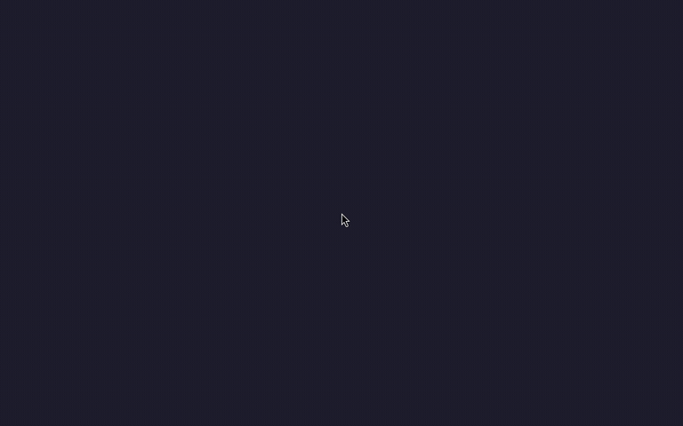

# wmsama

> An X11 reparenting compositing window manager written in Free Pascal, for the **Samarinda
> Desktop Environment**. Built on **florialib**, **AggPas** and **floria-toolkit**.

[](https://opensource.org/licenses/MPL-2.0)
[](https://www.freepascal.org/)
[](https://github.com/graemeg/pasbuild)

---

## Showcase



*Recording of vector window decorations, directional cursor feedback, outer-margin resize with no
client-area interference, edge snap tiling, divider resizing, and cursor-centred untile.*

---

## Features

### Decorations and compositing

- **Antialiased corners.** Top and bottom corner radii are configurable, default 12px, drawn with
  AggPas rather than pre-rendered bitmaps.
- **Built-in compositor.** Drop shadows with configurable blur radius and opacity, client damage
  tracking, and optional backdrop blur. No external compositor is needed.
- **Override-redirect windows.** Menus, popups, dropdowns and tooltips are registered with the
  compositor and stacked above managed windows.
- **Vector titlebar controls.** Close, Maximize/Restore, Minimize, Shade (rollup), Pin (sticky) and
  Window Menu buttons, drawn through `floria-toolkit`.
- **Panels stay on top.** `shellsama`'s panels are dock windows and are composited above ordinary
  windows, so a window dragged to the bottom cannot cover the taskbar. Fullscreen windows cover the
  panels; popup menus open above them. The same rule applies to X stacking, so clicks on an overlap
  reach the panel, and it holds with `--no-compositor` too.

### Resize from the outer margin only

- **Hit testing.** Resize is triggered only by the outer frame margin: four edges and four corners.
  The client area is never a resize target.
- **Client area intact.** The whole client surface belongs to the application. Terminal text
  selection from column 0, editor gutter clicks and native scrollbars do not start a resize.
- **Cursor feedback.** The pointer changes to the matching directional cursor
  (`top_side`, `bottom_left_corner`, ...) over a resize margin, and to `fleur` during a move.
  Resize cursors are applied to the resize window only, never to the frame or the client, so a
  client that defines no cursor of its own cannot inherit a stale one (WM-24).

### Edge snapping and tiling

- **Bounded dragging.** A move drag cannot put the titlebar above the top panel or below the bottom
  one: the limit is the work area, so the panels' struts are respected. When the window's bottom edge
  reaches the bottom of the work area there is a small detent — a few pixels of travel before the
  drag carries on. On a multi-monitor desktop the limit is the monitor the window is over, so a
  shorter screen stops it at its own edge.
- **Snap.** Dragging a window to the left or right screen edge tiles it to a 50% split.
- **Divider resize.** A tiled window constrains resizing to its dividing edge.
- **Untile and unmaximize.** Dragging the titlebar of a tiled or maximized window restores its
  floating size and centres the titlebar under the pointer. The pre-drag position is what gets
  restored, not the drag position (WM-21).

### Configuration

- **Button style:** `circle`, `squircle` or `square`.
- **Button alignment:** left or right.
- **Button layout:** for example `menu:shade,pin,minimize,maximize,close`.
- **Themes:** dark and light.
- **Alt+Tab:** a window switcher HUD, ordered most-recently-used.

### Extended client area (titlebarless windows)

Applications that draw their own titlebar can ask the window manager to drop the exterior frame and
reserve space for the buttons inside the client canvas. The client sets
`_NET_WM_EXTENDED_CLIENT_AREA = 1`; `wmsama` then frames the window with no titlebar, publishes
`_NET_WM_WINDOW_CONTROLS_INSET = [left, right, top, bottom]`, and overlays the window controls in the
reserved region. Button presses still go through `wmsama`, so they keep working when the client hangs.

`floria-toolkit` exposes this to applications as `ft_window_on_controls_inset_changed`. The protocol
is specified in
[`desktop-design-philosophy/08-extended-client-area-protocol.md`](../desktop-design-philosophy/08-extended-client-area-protocol.md).

---

## Project layout

```
wmsama/
├── project.xml                # PasBuild project descriptor
├── assets/
│   └── showcase.gif           # Live feature recording
├── docs/
│   └── roadmap.md             # Audit findings, fixes, evidence, progress log
├── src/
│   ├── main/pascal/
│   │   ├── wmsama.pas         # CLI entry point, signal handlers, config parser
│   │   ├── wmsama.core.pas    # Window manager engine, input routing, tiling, compositor
│   │   └── wmsama.ft.pas      # floria-toolkit vector button integration & styling
│   └── test/pascal/
│       ├── TestRunner.pas     # FPCUnit runner
│       └── wmsama.test.pas    # Unit and integration tests
├── scripts/
│   └── audit-docs.py          # Docs/code consistency gate (see below)
└── build.sh                   # FPC / Blaise / test wrapper
```

---

## Dependencies

- **Free Pascal Compiler (`fpc`)**, 3.2.2 or later
- **PasBuild**
- **florialib**: `Floria.XCB`, `Floria.XCB.WM`, `Floria.XCB.WM.Compositor`, `AggPas`
- **floria-toolkit (`libft.so`)**: vector widgets and window button rendering
- **X11 / XCB development libraries**: `libxcb`, `libxcb-render`, `libxcb-shape`,
  `libxcb-composite`, `libxcb-damage`, `libxcb-cursor`, `libxcb-keysyms`, `libxcb-icccm`,
  `libxcb-ewmh`

---

## Building and testing

```bash
./build.sh            # compile to target/wmsama  (pasbuild compile)
./build.sh test       # build and run the test suite (pasbuild test)
./build.sh clean      # remove target/
```

The suite in `src/test/pascal/wmsama.test.pas` covers window creation, frame metrics, snapping,
resizing, button placement, override-redirect compositing, cursor targets, the extended client area,
and the minimise/restore/maximise state machine.

Some tests need a live X server and skip themselves when one is not reachable.

---

## Usage

```bash
./target/wmsama [options]
```

| Option | Description | Default |
|---|---|---|
| `--display <name>` | Target X11 display (e.g. `:2`) | `$DISPLAY` |
| `--no-compositor` | Run as a plain reparenting WM without compositing | `false` |
| `--blur` | Enable backdrop blur | `false` |
| `--blur-radius <int>` | Backdrop blur radius | `15` |
| `--shadow-radius <int>` | Drop shadow radius, in pixels | `14` |
| `--shadow-opacity <flt>` | Drop shadow opacity, 0.0 – 1.0 | `0.35` |
| `--corner-radius <int>` | Top corner radius, in pixels | `12` |
| `--bottom-radius <int>` | Bottom corner radius, in pixels | `12` |
| `--button-style <style>` | Button shape: `circle`, `squircle`, `square` | `circle` |
| `--button-alignment <align>` | Button alignment: `left`, `right` | `left` |
| `--buttons-left` | Shorthand for `--button-alignment left` | (default) |
| `--buttons-right` | Shorthand for `--button-alignment right` | `false` |
| `--button-layout <lay>` | Custom button order, e.g. `menu:shade,pin,minimize,maximize,close` | auto |
| `--theme <theme>` | Colour theme: `dark`, `light` | `dark` |
| `--libft <path>` | Path to `libft.so` | auto |
| `--help`, `-h` | Usage | — |
| `--version`, `-v` | Version | — |

---

## Diagnostics

`Super+Shift+D` dumps the composited scene and each window's surfaces to disk. Useful for
investigating a rendering artifact from pixels instead of a screenshot.

| Variable | Effect |
|---|---|
| `WMSAMA_DEBUG=1` | Log X errors and state transitions to stderr |
| `WMSAMA_DUMP_DIR=<path>` | Where `Super+Shift+D` writes (default `/tmp/wmsama-dump`) |

The dump contains:

- `scene.raw`: the composited scene, BGRA32, `width * height * 4` bytes
- `scene.txt`: window list, geometry, compose and present rects
- `frame-<id>.raw`: a window's frame decorations, on their own
- `client-<id>.raw`: the same window's client content

The frame and client surfaces are dumped separately because the compositor captures them
separately (see WM-20 in the roadmap). No image writer is registered in `florialib`, so convert
outside:

```bash
magick -size 1280x800 -depth 8 BGRA:scene.raw scene.png
```

---

## Docs gate

`scripts/audit-docs.py` checks the documentation against the code and exits non-zero on a
mismatch. It catches the failures that are invisible in review:

- a CLI flag documented in the README that `--help` does not accept
- a CLI flag in `--help` that the README does not document
- a roadmap item whose heading status contradicts its progress-log rows
- a roadmap item missing from the findings summary table
- a test name or `.pas` file cited in the docs that does not exist

```bash
python3 scripts/audit-docs.py           # check
python3 scripts/audit-docs.py --list    # also list every citation it resolved
```

Run it after editing the README, the roadmap, or the CLI. It needs no X server and no build.

---

## Running in a nested X server

X11 allows only one window manager to hold `SubstructureRedirect` per display, so do not run
`wmsama` on your primary session. Use Xephyr:

```bash
# 1. Nested server
Xephyr :2 -screen 1024x768 -ac &

# 2. wmsama inside it
./target/wmsama --display :2 &

# 3. Clients
DISPLAY=:2 xterm &
DISPLAY=:2 xcalc &
```

---

## License

Mozilla Public License 2.0 (MPL-2.0). See [project.xml](project.xml).

---

## Author

**Dio Affriza** — Samarinda Desktop Environment Project
